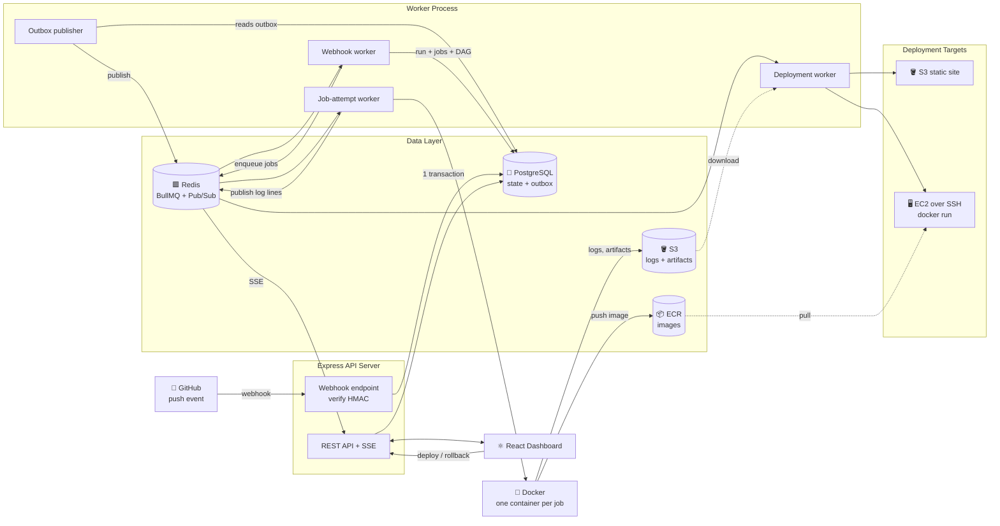
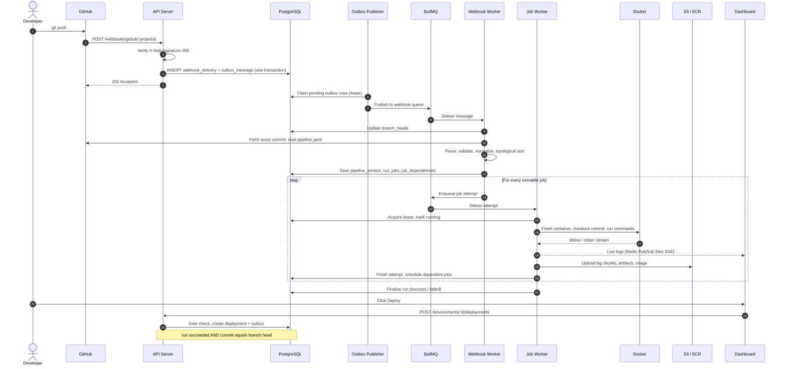
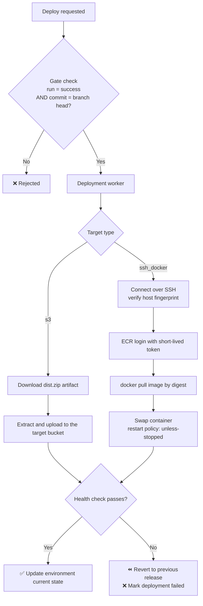

<div align="center">

# DeployBench

**A self-hosted CI/CD platform. Every job runs in an isolated Docker container, and successful builds deploy to S3 or EC2.**


</div>

---

## 🎥 Demo

[▶️ Watch DeployBench Working Demo on YouTube](https://www.youtube.com/watch?v=Ps28MnUJizc)

---
## 📖 Overview

DeployBench is a mini GitHub Actions / Jenkins that you host yourself. Push to GitHub, and DeployBench:

1. 🔐 Receives and verifies the webhook
2. 📄 Reads `.cicd/pipeline.yaml` from the **exact commit** that was pushed
3. 🧱 Runs each job in a **fresh, isolated Docker container**, in dependency order
4. 📡 Streams live logs to the browser
5. 📦 Stores logs and artifacts in S3, and Docker images in ECR
6. 🚢 Deploys the result to **S3 (static frontend)** or **EC2 over SSH (container from ECR)**, with a health check and rollback

---

## ✨ Features

| | Feature |
|---|---|
| 🪝 | GitHub webhooks with HMAC-SHA256 signature verification |
| 📬 | Transactional **outbox pattern**, so no webhook is lost between Postgres and Redis |
| 🧩 | Pipeline-as-code in YAML, with a validated DAG (`needs`) and cycle detection |
| 🐳 | Every job attempt runs in a fresh container with CPU, memory and timeout limits |
| 🔁 | Retries decided by the database (`retries` in YAML), with leases and heartbeats |
| 📺 | Live logs over **SSE** (Redis pub/sub), durable logs in S3 |
| 🔑 | Project and environment secrets, encrypted with AES-256-GCM and masked in logs |
| 🛡️ | **Latest commit wins** deployment gate: an old or failed commit can never overwrite a newer one |
| 🩺 | Health checks after each deployment, with automatic revert on failure |
| ⏪ | One-click rollback to a previous known-good release |
| ☠️ | Dead-letter records for events that cannot be processed, with replay |

---

## 🏗️ Architecture



### The three queues

| Queue | Job |
|---|---|
| `webhook` | Update branch head, read the pipeline file, create the run, jobs and dependencies |
| `job-attempt` | Execute one attempt of one job inside Docker |
| `deployment` | Deploy a successful run to an environment and verify it |

PostgreSQL is the **source of truth**. Redis and BullMQ are only transport, and retries are owned by the database (`attempts: 1` on every BullMQ job).

---

## 🔄 How a push becomes a deployment



---

## 🚢 Deployment

Deployment targets are configured per **environment**, never in the pipeline file.



| Target | Release source | What happens |
|---|---|---|
| 🪣 **S3 static site** | Artifact (for example `dist.zip`) from the build job | Extract and upload to the configured bucket and prefix |
| 🖥️ **EC2 + Docker over SSH** | Image built in the run and pushed to ECR | Pull by digest, replace the container, run with `--restart unless-stopped` |

**Deployment rules**

- A run can deploy only if `run.status = success` **and** `run.commitSha = branch_heads.commitSha`.
- A failed deployment never changes the environment's current release.
- Only one deployment per environment can be active at a time.
- Rollback targets a previous successful deployment and skips the gate.

---

## 📄 Pipeline file

Pipelines live in the user's repository (default `.cicd/pipeline.yaml`) and are read at the exact commit SHA, so an old commit always builds with the pipeline it had.

```yaml
version: 1

jobs:
  test:
    name: Run tests
    image: node:20
    commands:
      - npm ci
      - npm test
    timeout: 600        # seconds
    retries: 1          # extra attempts
    env:
      NODE_ENV: test
    secrets: [NPM_TOKEN]

  build:
    image: node:20
    needs: [test]
    commands:
      - npm ci
      - npm run build
    artifacts:
      - name: dist.zip
        path: dist

  image:
    needs: [test]
    docker_build:
      dockerfile: Dockerfile
      context: .
```

| Field | Meaning |
|---|---|
| `needs` | Jobs that must finish first. Forms the DAG. Independent jobs run in parallel |
| `timeout` / `retries` | Per-attempt time limit and number of extra attempts |
| `allow_failure` | A failure does not fail the run |
| `secrets` | Project secrets injected as environment variables and masked in logs |
| `artifacts` | Paths collected after a successful job and uploaded to S3 |
| `docker_build` | Builds and pushes an image to ECR, tagged `run-<runId>` |

Each job gets a fresh container and a fresh checkout. Jobs never share files.

---

## 🧠 Design decisions

| Decision | Why |
|---|---|
| **Outbox pattern** | Postgres and Redis cannot commit atomically. The outbox row is written in the same transaction as the webhook, then published later with leases |
| **DB-owned retries** | One place decides retries (`max_attempts`), so BullMQ and the app never double-retry |
| **SSE instead of WebSockets** | Log streaming is one-way, and SSE works over plain HTTP with auto-reconnect |
| **S3 for durable logs, Redis for live logs** | Redis is temporary transport, S3 is the permanent record |
| **Fresh container per job** | No job depends on state left behind by another |
| **Docker CLI via `child_process.spawn`** | Simple `build`, `push` and `login`, and every command can be reproduced in a terminal |
| **Deploy by image digest** | The exact image CI built is the one that runs |
| **Leases and heartbeats** | A crashed worker's attempt is detected and recovered |

---

## 🛠️ Getting started

### Prerequisites

- Node.js 24+
- Docker (the worker needs access to the Docker daemon)
- PostgreSQL and Redis
- An S3 bucket for logs and artifacts, and an ECR repository for images
- A public URL for webhooks (for local development, use ngrok or Cloudflare Tunnel)

### Run it

```bash
# 1. Install dependencies
cd server && npm install
cd ../client && npm install

# 2. Configure environment variables
cp server/.env.example server/.env      # fill in database, Redis, AWS and encryption settings

# 3. Create the database tables
cd server && npx drizzle-kit migrate

# 4. Start the API server, worker and client (separate terminals)
cd server && npm run dev                # API + SSE
cd server && npm run worker         # outbox publisher + webhook, job and deployment workers
cd client && npm run dev                # dashboard
```
</div>
